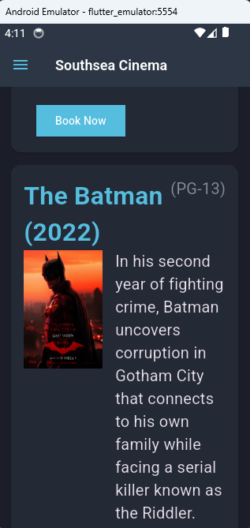
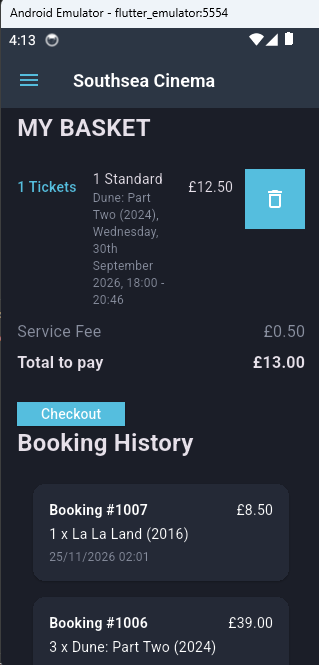

# Southsea Cinema

Southsea Cinema is an Android app for browsing films, choosing tickets and managing cinema bookings.

## Features

- Browse films and view their details, prices and screening times.
- Choose ticket quantities and add tickets to your basket.
- Remove tickets and see the service fee and total.
- Check out and view saved bookings.
- Save profile and newsletter settings.
- Switch between dark and light mode; the choice is remembered.

Bookings are stored locally in SQLite. App preferences are stored on the device.

## Supported platform

Android only.

## Install dependencies

Install Flutter and Android Studio with the Android SDK, then from the project folder run:

```bash
flutter pub get
```

## Run on an Android emulator

Start an Android emulator in Android Studio's Device Manager. Then run:

```bash
flutter devices
flutter run -d <emulator-id>
```

Replace `<emulator-id>` with the Android emulator ID shown by `flutter devices`.

## Run tests

```bash
flutter test
```

## Screenshots

### Films



### Basket


